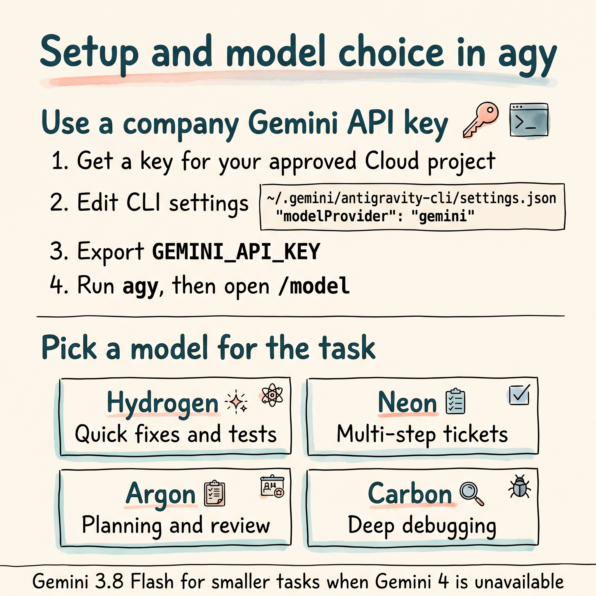

# Gemini Agent Workflows

A starter kit for picking a Gemini model and running repeatable engineering tasks in Antigravity CLI or desktop. The examples come from my setup for keeping Jira, tests and project docs moving while I recovered from surgery. [Read the story](https://medium.com/@hassanabid/four-weeks-with-ai-agents-on-a-mac-mini-618320ebdfdd).

## Which Gemini model should I use?

| Start with | Good first task |
| --- | --- |
| Gemini 4 Hydrogen | A small patch, a focused test, a doc update or a quick repo lookup |
| Gemini 4 Neon | A Jira ticket that needs investigation, changes across files and verification |
| Gemini 4 Argon | An implementation plan or a separate review of a migration or cross-module change |
| Gemini 4 Carbon | A difficult bug with competing explanations or a long investigation across services |
| Gemini 3.8 Flash | A fallback for scoped tasks when Gemini 4 is unavailable |
| Nano Banana 2.1 | Creating or editing an illustration, mockup or sketchnote |



These are starting picks. [See when to switch and how to compare models](.agents/skills/choose-gemini-model/references/models.md).

## Run a skill

Clone this repository, then change into it before starting Antigravity CLI.

```bash
git clone https://github.com/hassanabidpk/gemini-agent-workflows.git
cd gemini-agent-workflows
agy
```

- **CLI.** Open `/model` to choose a model and `/skills` to see the available skills. Use `/skills reload` after editing a skill.
- **Desktop.** Create a project and use **Add Folder** to select the checkout. Choose a model below the conversation box. Check **Settings → Projects → your project → Customizations → Skills**.
- **Both.** Enter a command below in the conversation. Copy the relevant skill folder into your own repo’s `.agents/skills/` to use it there. Include its supporting files.

| Command | Example prompt |
| --- | --- |
| `/choose-gemini-model` | Choose a model for a bug involving three modules and one integration test. |
| `/implement-ticket` | Implement the ticket I pasted and show the focused test results. |
| `/review-runbook` | Review the staging health-check runbook against the current repo. |

See [Antigravity skill discovery](https://antigravity.google/docs/customization-discovery/) and [model selection](https://antigravity.google/docs/models).

If you use `agy` for company work, you can use a Gemini API key tied to an approved Cloud project or sign in with company-managed access. [Illustrated setup and model picker](docs/agy-authentication.md#setup-and-model-choice).

## Try the workflows in your repo

- [One Jira ticket and focused QA](workflows/jira-ticket.md) covers scope, implementation, tests and handoff.
- [Check your OKF docs](workflows/okf-docs.md) shows how to start an OKF bundle and run a read-only documentation review in either Antigravity surface.

External tools such as Jira and Android use the integrations already configured for the target project. You can also paste the ticket and use the repo’s own build and test commands.
